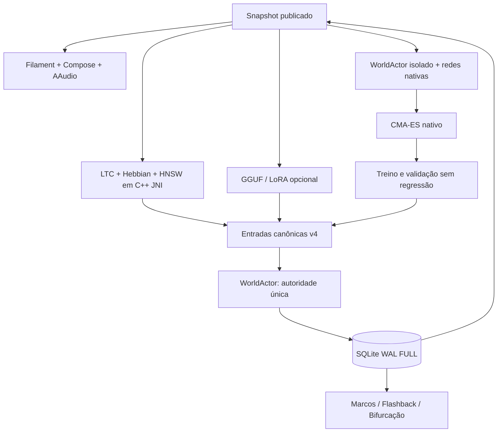

<!-- coderabbit-ai-generated:v1 -->

<!-- coderabbit-ai-generated-section:v1:2ec3c2651ea0ae8767293debda4fafb1d5953cb790d1ae7010b4ec6a7dc94508 -->

<!-- coderabbit-ai-generated-section:v1:dba1a4a944baaf52c56992b93d64958f859923a14055c7e81d817ceee677be64 -->

# Arquitetura inicial e interpretação dos anexos

## Fontes recebidas

Os seis arquivos são especificações e exemplos sobrepostos, não um checkout compilável. O PDF possui 39 páginas. A leitura estrutural abrangeu seções, contratos, classes, funções, fórmulas, exemplos, referências e roteiro dos arquivos. O código de referência requer integração e verificação independente; declarações de auditoria ou benchmarks nos anexos não estabelecem resultados neste repositório.

| Arquivo de entrada | Bytes | SHA-256 |
| --- | ---: | --- |
| A_gera_o_autom.txt | 98303 | `9c7bdd969cf34e06f45e83f9191a91aec44be1351f82e3729c7e7a5d5179c9bb` |
| 1._Ponte_JNI_C_.txt | 280003 | `47820205f9cb58ceb2d8b8060d638065d0615afe90f2f02e646373e4d2433258` |
| Girassol_RSI_Fronteiras_Pesquisa_Profunda_Hip_teses_e_Implementa_o_Nativa.md | 30418 | `033491a850f3784c0cac49a0f668de4b9ce9186d29115c6f6337cfa0f1bc7e2c` |
| Links_teis_e_Refer_ncias_para_o_Ecossistema_Girassol.md | 9083 | `9436553ad733de128863ff109d625c6a52114b1610f2fd28ff097d0dca7e635e` |
| Girassol_Arquitetura_Mestre_GEA_Teorias_Avan_adas_e_Plano_de_Execu_o_24-7_1_.pdf | 1137695 | `2ebe7189891b851dfa89caf84d32f4463bc05f00bae280ce8e0de5de7dced2cb` |
| Completo.md | 110569 | `299cd783fb1a01b9a6ea1909fb612f412d0109381f9be4a51be6831d5a994725` |

## Arquitetura atual — incremento 0.9 (fontes não executadas)

## Compatibilidade e decisões

- **Autoridade e tempo:** WorldActor continua Kotlin/JVM, independente do renderer/áudio e do relógio físico. Componentes C++ propõem decisões e produzem apresentação. A adoção da transição ocorre depois de sua transação durável; falha de gravação não avança o ator adotado.
- **Economia:** seção29 de Completo exige conservação estrita. Consumo transfere para ambiente/arquivo/estruturas; reciclagem devolve às contas de mercado e salários usam moedas existentes. Não há criação de matéria ou moeda após a gênese.
- **Diário:** eventos1/2 e fixtures200eventos permanecem inalterados. Evento3 acrescenta proposta GGUF. Evento4 recebe CognitiveFrame com identidade do snapshot de origem, parâmetros LTC, Big Five, memória e decisões. Evento5 mantém o contrato espacial legado. Evento6 usa o mesmo envelope espacial para registrar ticks sob regras v6, que adicionam GOAP determinístico, construção em espiral e genealogia. Campos novos vazios/nulos são omitidos para preservar hashes antigos. Frames são copiados defensivamente, inclusive vetores internos. O replay recompõe e compara eventos em ator temporário antes de adotá-los; não exige backend nativo.
- **Persistência:** SQLite schema2 acrescenta a tabela de marcos com snapshot integral/digest/hash do evento. A migração não reescreve registros antigos. Flashback verifica snapshot e vínculo ao diário; bifurcação copia o prefixo para outro banco e valida a cópia antes de trocar a linha ativa. Não se usa arquivo `world_snapshot.bin` separado. Diários completos são mantidos; poda segura requer futuro protocolo de âncoras e retenção histórica.
- **JNI:** vértices32bytes (posição float3, quaternion float4, RGBA8); malhas e estados de cálculo usam DirectByteBuffer e validação de capacidades. Há upload CPU→GPU e cópias locais para alinhamento/validação; não se afirma ausência total de cópias.
- **Renderer:** Filament1.56.0, PBR procedural e vidro separado, IBL com convolução difusa e prefiltragem GGX, sombras/SSAO/ACES/bloom/antialiasing. Passagem offscreen com acabamento próprio. Céu/clima são apresentação reprodutível, sem autoridade meteorológica sobre o mundo. Aparência, precisão do picking e ciclo de vida GPU ainda precisam de aparelho.
- **Aprendizagem:** tinymind LTC12×8 e leitura de oito ações; atualização Hebbiana/Oja pelos resultados registrados. Novidade é kNN de descritores comportamentais. Duas dimensões Big Five usam traços genéticos existentes; as demais são inicializadas pelo PRNG. Não há alegação verificável de consciência ou livre-arbítrio, reprodução ou NEAT estrutural.
- **Memória:** episódios vetoriais observacionais16D persistidos no estado, HNSW temporário em RAM, score recência/importância/similaridade; reflexões estatísticas durante repouso; rotinas validadas e ensino próximo. Isso não equivale a embeddings semânticos linguísticos, síntese livre de teorias ou biblioteca de programas Voyager.
- **RSI:** CMA-ES próprio em C++ com matriz completa, caminhos cumulativos e adaptação do passo; otimiza oito vieses compartilhados. O sandbox executa WorldActor/redes reais por256ticks, com treino e janela disjunta de validação. Ganho>0,03 e dominância sem regressão são necessários nas duas. A hipóteseH1 cita0,03 e outro exemplo0,025; adota-se0,03. Proveniência liga pesos, métricas, origem e algoritmo ao SQLite. Políticas distritais e evolução estrutural permanecem pendentes.
- **GGUF/LoRA:** llama.cpp b4514, arquivos privados por hash e indexação atômica; adaptador aplicado ao modelo carregado daquela inferência e liberado antes do contexto. Os pesos GGUF não são treinados online. Saída restrita a atividade, sem geração neural de diálogo/leis/cidade. Importação não possui teto fixo512MB, mas conserva checagens de RAM/disco/temperatura. Contexto512 e resposta64tokens são parâmetros operacionais do protocolo atual, não promessa de compatibilidade universal.
- **Áudio:** síntese C++ separada do mundo e controlada por observações, sem bloqueios/alocações explícitas no callback. Foco, lifecycle e liberação acontecem na thread de controle. Saída física e qualidade ainda não verificadas no sandbox.

## Dependências incorporadas

| Componente | Revisão | Licença / integração |
| --- | --- | --- |
| Filament |1.56.0 / matc56| Apache2.0; Android AAR e materiais pré-compilados verificáveis |
| llama.cpp |b4514, ec7f3ac9ab33e46b136eb5ab6a76c4d81f57c7f1| MIT; archiveSHA256 fixado no CMake |
| tinymind LTC |f63f8ae9a74868050b02b115d3484c296ae50199| MIT; cabeçalhos transitivos preservados, ORIGIN.txt |
| hnswlib |ca426729609b3221563047ceb269cc1213e0d376| Apache2.0; NoExceptions, -fno-exceptions, ORIGIN.txt |

HNSW utiliza a opção upstream `HNSWLIB_USE_PREFETCH=0`. O caminho SSE de lookahead padrão apresentou heap-buffer-overflow no teste ASan de inserção; a configuração de produção e a de teste desativam esse caminho. Os cabeçalhos vendorizados não foram alterados. O algoritmo CMA-ES é implementação própria das equações de Hansen, sem copiar/vincular libcmaes. As demais bibliotecas sugeridas nos pedidos são referências, não dependências fictícias.

## Pendências da especificação

1. Recast/Detour, RVO2 completo e navegação de múltiplos andares. Há A* e steering com colisores derivados da cena e, em regras6, planner GOAP/utility próprio de horizonte curto; GPGOAP não foi integrado como dependência.
2. WFC ponderado em blocos17×17 com seis arquétipos de distrito, lotes em espiral e conectores cívicos nas bordas está integrado em regras6. Earcut/triangulação de polígonos urbanos, interiors em múltiplos andares e economia produtiva espacial permanecem pendentes. A geometria nativa ainda tem envelope de coordenadas e precisa de streaming por blocos para escala geográfica muito grande. O mundo começa com seis fundadores.
3. Regras6 geram descendentes de pares com confiança recíproca, recombinam loci determinísticos, registram hash genético e árvore familiar no estado canônico e transmitem habilidades que já foram validadas como compartilháveis. Mortalidade, expectativa de vida, herança Big Five completa e mutação estrutural NEAT permanecem pendentes.
4. Instituições/leis/comércio emergentes, linguagem com adoção social e geração GGUF livre validada.
5. Reflexão neural e biblioteca de habilidades executáveis generalizáveis. Embeddings GGUF completos/HNSW da biblioteca foram integrados no incremento0.8; vetores de episódios continuam observacionais16D.
6. RSI distrital/estrutural, treinamento LoRA e confirmação de um adaptador compatível real.
7. Compactação/poda com âncoras criptográficas, preservação das bifurcações e política de retenção.
8. Direção cinematográfica automática e maratona física em Android13+/ARM64/8GB e12GB com medição de FPS, memória, temperatura e áudio.

## Física e pesquisa incorporadas após0.7

- `physics/spatial.cpp`: grade com resolução base de10cm e densidade adaptada para um orçamento de aproximadamente32MiB de índices, obstáculos construídos dos triângulos publicados da cidade, A*, verificação de segmentos, steering/reserva de espaço e circle-vs-AABB. Gravidade integra em1/60s,30subpassos por ciclo lógico. A dimensão da grade acompanha os limites da cena. Há cache por thread/revisão/seed e buffers JNI diretos.
- `SpatialFrame`: entrada canônica5 no replay histórico e versão6 nas novas regras; ambos vinculam hash do estado anterior, caminho físico, apoio, velocidade vertical e intenção. O núcleo adota posições antes da arbitragem e a persistência continua precedendo a publicação. Campos vazios são omitidos dos estados e eventos anteriores.
- `ContactShadows` e `contact_shadow.mat`: buffers compartilhados e instâncias por cidadão, transparência radial, escala/densidade moduladas pela distância ao apoio. Respiração preserva os pés; marcha depende da distância apresentada.
- `research/` e banco schema4: currículo, aquisição HF imutável, quarentena, embeddings GGUF/HNSW, cache Range/mmap e estudo físico. Consulte `biblioteca.md`. O estudo aceita pontos de interação livres dentro da biblioteca no novo espaço físico, preservando a regra de proximidade nos estados legados.
- Permanecem pendentes objetos soltos/empilhamento, andares arbitrários, resolução completa de impasses de multidão e os módulos dedicados Shizuku/DGM/OpenCL/treino LoRA.

## Validação e limites

`.github/workflows/android-ci.yml` executa automaticamente em push/PR: toolchain Android/JDK/NDK fixada, compilação Filament1.56.0 por SHA256, `scripts/test-native.sh` (ASan/UBSan), `test` (suítes JVM de todos os módulos), `testDebugUnitTest`, `lintDebug`, `assembleDebug` e `assembleRelease`, com publicação dos APKs ARM64 em artefatos separados. A aprovação do workflow é a condição para afirmar sucesso da compilação; a existência do workflow ou de testes adicionados não é evidência de aprovação. O workflow manual `.github/workflows/android.yml` continua disponível. Não se inicia emulador.

O host pode executar código de produção Kotlin/JNI para testar aprendizagem e Shadow-Replay sem Android. Isso não valida GPU, framework SQLite Android, SAF, AAudio/foco ou comportamento de aparelho. Instrumentação compilada não equivale a instrumentação executada. A meta60FPS não é uma medição. Os resultados exatos e hashes dos inputs/artefatos são mantidos no registro de validação do workspace, separado do repositório.

<!-- /coderabbit-ai-generated:v1 -->

## Formato GRS e áreas da interface

- `GirassolRecordCodec` implementa .grs versão1 com header validado, SHA-256, Float32, INT8 delta-varint e ternário de2bits. `AdaptiveQuantizerEngine` seleciona por RMSE/bytes. O codec é puro e testado; migração da persistência SQLite/HNSW antiga e compressão Zstd não foram conectadas, portanto nenhum histórico é reescrito.
- A navegação Compose organiza cinco áreas: Biosfera, Gênesis/Cidadãos, Pedidos/Biblioteca (intenções reais do diário), Hugging Face/Plugins (pesquisa atual) e Marcos/Laboratório/Sistema. A visualização da genealogia está na área Gênesis; o inbox exibe os pedidos de currículo que já existem no armazenamento.

## Ingestão de documentos via Storage Access Framework

O picker SAF permite selecionar TXT, Markdown, CSV, JSON e EPUB. A leitura ocorre no executor de pesquisa; EPUB é extraído de entradas XHTML/HTML com limite de expansão, e o texto é dividido em trechos compatíveis com o parser de datasets. Cada lote local é associado ao cidadão/ciclo, recebe SHA-256 e passa por `ResearchTables.acquire`, reutilizando o diário encadeado e a quarentena de duas revisões. A importação respeita o limite atual de2MiB por aquisição e até100 trechos; não reescreve snapshots nem eventos do mundo. PDF e áudio ainda não são aceitos, pois os extratores nativos pdftext/MediaExtractor+FFT da especificação ainda não foram implementados.
